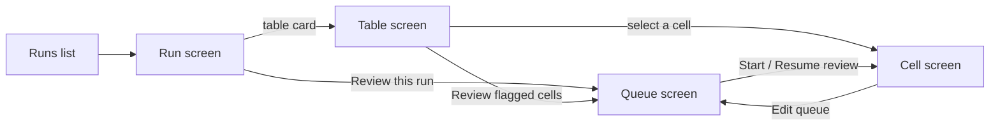

# 013 - Review app: browse extracted tables and review the grounding

Status: implemented (browser checks of tasks 011-014 done in Chrome only).
The design is the mockup file [quotable review app.html](quotable%20review%20app.html) in this
folder, described in "Visual design".

## Summary

A local web app, started with `quotable review`, that lets a person look at what
`extract_tables` produced and check it against the PDF:

- **Browse.** Every run of `extract_tables` in a project, every table of a run, every row and
  cell of a table, each cell's grounding status, and the PDF page it came from with the matched
  words highlighted.
- **Review.** Walk through flagged cells (or a random sample of them), look at each one on the
  page, and record a verdict: correct, changed (with the right value and why the model was
  wrong), or can't tell. The app shows how many values are wrong with a confidence interval.

Verdicts are stored as an audit file in `.quotable/review/`. They do not change the output of
`extract_tables`, `records()` or the DataFrames (see Out of scope).

To make this possible, `extract_tables` saves each run's results to `.quotable/runs/`, the way
spec 011 saves each request's cost to `.quotable/cost/`.

```console
$ quotable review
Serving the review app at http://127.0.0.1:8765 (Ctrl+C to stop)
Runs: 12 in .quotable/runs/
```

The app is modelled on the two review apps of the original project
(`apps/grounding_review/` and `apps/unmatched_review/` in the VRA community-projects
repository). Most features below come from `grounding_review`; the row list, filters, pager
and full-PDF view come from `unmatched_review`. What is specific to VRA (matching rows to House
requests) is not carried over.

## Motivation

- Grounding says which values were found in the PDF's text, but someone still has to look at
  the flagged ones. Today that means printing `table.flagged()`, opening the PDF by hand and
  finding the page, row and column.
- The original project needed a review app to trust its numbers. Every user of quotable has the
  same need, and the library already holds everything the app shows (values, statuses, boxes,
  text layers, recheck proposals, merges, OCR pages).
- A sampled review with a confidence interval answers "how good is this extraction?" with a
  number instead of an impression.

## Terms

- **Run**: one call of `extract_tables` on one PDF. It has an id (the run id spec 011 already
  writes into every cost record), a time, a model, the settings, and the tables it returned.
- **Cell**: one value of one row of one table (a PDF column).
- **Extra field**: a value printed outside the table (spec 010). It belongs to the page that
  prints it and is copied onto every row of that page (and of later pages when carried
  forward). It is reviewed once per printing page, not once per row.
- **Flagged**: a cell or extra field whose status is not `exact`, `empty` or `not_on_page`
  (`grounding.UNFLAGGED`), as `Table.flagged()` defines it.
- **Verdict**: a reviewer's decision about one cell or extra field: `correct`, `changed` or
  `unsure`.

## Requirements

### A. Saving runs

1. **Every run is saved.** When `extract_tables` (or `extract_tables_async`) returns, it writes
   the run to `.quotable/runs/<run id>/` in the current working directory, using the same run id
   as the cost log. Like costs, the location does not depend on `cache_dir`. No new parameter
   (user decision).
2. **What a run holds.** Enough to show everything in sections B to D without the model, the
   cache or (except for page images) the PDF:
   - Run: format version, run id, start and end time (UTC), quotable version, model name as the
     cost log writes it, the settings that change results (`discovery_pages`, `recheck`, `ocr`,
     `merge_reworded`, `extra_fields` with their descriptions, `max_requests`).
   - Document: the PDF's file name, absolute path, size, SHA-256 and page count. The PDF itself
     is not copied (user decision); page images are rendered from the file at that path, and
     the app says so when it is missing or changed (C2, C5).
   - Each table, in the order `extract_tables` returned them: its index, `label`, `columns`,
     pages, `ocr_pages`, `position` counts, `layouts` (per page: columns and whether the header
     was found or inherited), `merged` parts with their `MergeEvidence`, `proposals` (every
     recheck proposal with its outcome), `extra_names`, `extra_fields`, `extra_changes`.
   - Each row: page, row number, values, and each cell's grounding (`status`, `coverage`,
     `density`, `n_candidates`, `matched_text`, `bbox`, and the box of every candidate).
   - Each page of each table: the text layer's words with their boxes (from OCR on an OCR'd
     page), the page size, the table's band of the page when it shares the page with another
     table (spec 004), and the areas the position check fitted: each row's vertical window and
     each column's horizontal range (requirement A5).
3. **A failed run saves nothing.** If `extract_tables` raises (`TextLayerError`,
   `BudgetExceededError`, `ExtractionError`, `OcrUnavailableError`, anything else), no run
   folder is left behind. A run is written to a temporary name and renamed into place when
   complete, so the app never sees a half-written run.
4. **Saving can never break an extraction.** If the folder cannot be written, quotable warns
   once on stderr and returns the tables as usual (as spec 011 requirement 7).
5. **The position check keeps its areas.** Today `check_positions` fits row windows and column
   ranges, uses them and throws them away. It keeps them so the run can store them. Its
   verdicts, counts and the rest of the pipeline do not change.
6. **Nothing else changes.** Cache keys, prompts, answers, `max_requests`, the cost log, the
   public API and `quotable.__all__` stay as they are. A run that is answered entirely from the
   cache is still saved (it is a run; it costs nothing).
7. **Runs pile up.** Nothing deletes old runs. Deleting `.quotable/runs/<run id>/` removes a
   run; deleting `.quotable/runs/` removes all of them and leaves the cache, costs and reviews
   alone (spec 011's one-folder-per-kind rule).

### B. Starting the app

1. **`quotable review`** is a new subcommand of the existing `quotable` command (next to
   `cost-report`; `python -m quotable review` works too). It starts a local web server, prints
   its address, and opens the default browser on it.
   - `--dir PATH`: the project's `.quotable/` folder, as for `cost-report`. Default: the one in
     the current directory.
   - `--port N`: default 8765 (user decision). If the port is taken, exit 1 with a message
     that says so and suggests `--port`.
   - `--no-browser`: print the address but do not open a browser.
   - `--run ID`: open straight on this run.
   - No runs yet: the app still starts and says how to make one (run `extract_tables`).
   - Ctrl+C stops it; exit 0. A usage error exits 2 (argparse's default).
2. **Local only.** The server listens on 127.0.0.1 only, has no login, and rejects any request
   whose `Host` or `Origin` header is not `127.0.0.1:<port>` or `localhost:<port>` (this stops
   a web page in the same browser from reading or writing through it).
3. **Read-only except for reviews.** The app never changes a run, the cache, the cost log or
   the PDF. The only files it writes are in `.quotable/review/` (section F).
4. **Untrusted text is shown as text.** Values, PDF text, model answers, labels, column names
   and notes are always displayed as plain text, never interpreted as HTML.
5. **It only serves what it knows.** Files are reached by run id and page number, never by a
   path from the browser. A run id must name a folder in `.quotable/runs/`; a page number must
   be a page of that run's document.
6. **No new dependency.** The server uses the standard library; pages are rendered with
   PyMuPDF, which quotable already depends on. The browser side is static HTML, CSS and
   JavaScript files inside the package, with no framework and no build step (user decision).
7. **No network.** The app loads nothing from the internet: scripts and styles are files of the
   package, and text uses the system's own fonts (the mockup's Google Fonts are not used).
   Every response carries a `Content-Security-Policy` that allows only the app's own origin,
   so a value that slipped through as markup still could not load or send anything.

### C. Browsing

Five screens: runs list, run, table, review queue, and cell (the page next to the cell view).
Every screen has the same header: the name "quotable review", a breadcrumb back to the runs
list (Runs / file name · short run id / Table N · label / Review), and the server address. The
runs list shows the project's `.quotable/` path next to the address.

A run is named by its id as stored (spec 011: `uuid4().hex`); the **short run id** shown in
lists and breadcrumbs is its first 8 characters. Models are shown as recorded
(`provider:model-name`).

1. **Runs list** (the start screen).
   - Title "Runs" and a line "N runs of M documents in `.quotable/runs/`, newest first.
     Re-runs of the same PDF are grouped."
   - Filters: document (text, matches the file name) and model ("All models" or one model).
   - One group per document (same SHA-256), the group with the newest run first. The group's
     heading: file name, SHA-256 shortened to its first and last 4 characters, page count,
     size in MB, and the number of runs.
   - One line per run in the group, newest first: short run id (link to the run screen), time
     (local: "Today 10:14", otherwise "Oct 19, 16:40"), model, tables, rows, cells, flagged
     cells by status (fuzzy, misplaced, ungrounded, untokenized, each with its count, then
     "= total"), OCR'd pages, cost, and review progress (a bar and "reviewed / flagged",
     followed by "· done" when every flagged cell has a verdict).
   - Cost is the sum of the run's records in the cost log: dollars, "free" when every answer
     came from the cache, "unknown" when a record has no price. A note under the list says so.
2. **Run screen.**
   - Heading: "Run <short id>", the file name, and one line: start–end time, model, tables,
     rows, flagged cells, cost.
   - A main button "Review this run · reviewed / flagged" that opens the review queue scoped
     to this run.
   - **Run** card: full run id, started and ended (UTC, `2026-10-20 14:14:07Z · 14:31:52Z`),
     model, quotable version, run format version, and "Settings that change results" as
     `name=value` chips (`discovery_pages`, `recheck`, `ocr`, `merge_reworded`,
     `max_requests`), then each extra field's name and description.
   - **Document** card: file name, path, size and page count, SHA-256 (shortened).
   - **Tables**, "in the order extract_tables returned them": one card per table, linking to
     the table screen: "Table N · pages 3–41", the label (or only "Table N" when the model gave
     none), the columns joined by " · " with the extra fields after "+" and marked "(extra)",
     and four numbers: rows, flagged, merged parts, OCR pages (count and page numbers).
   - Under the numbers, a **note** of the facts the numbers hide, each part only when it
     applies, left out when none does (user decision; the mockup prepares it but does not draw
     it):
     - each merged part: "Merged part: pp. 22–24, columns <its original column names>";
     - accepted recheck changes: "57 recheck changes accepted";
     - each page shared with another table: "Shares p. 58 with Table 1; each has its own band
       of the page".
   - **PDF missing or changed**: an alert above the cards. Missing: "The PDF is missing. Page
     images can't be shown. Values, statuses and text still can." and "not found: <path>".
     Changed: "The PDF's SHA-256 no longer matches." with the same second sentence and
     "expected <short> · found <short>". The rest of the screen is unchanged.
3. **Table screen.** The table's rows as a grid, in the order of `records()`: page, row, the
   values, the extra fields.
   - Heading: "Table N · pages · rows · merged parts · OCR on p. …", then the label. Two
     buttons: "Review flagged cells" (the review queue scoped to this table) and "Download N
     rows as CSV" (the rows that match the filters, same columns as `records()`).
   - **Summary**: "Cells by status · total" as one stacked bar over all seven statuses with
     each status's count under it; position check ("318 misplaced · 41 unchecked"); recheck
     ("57 changes accepted").
   - **Filters**:
     - one toggle per status, all seven, each with its count. A row matches when one of its
       cells has a selected status (only the chosen column's cell, when a column is chosen).
       No toggle on means any status;
     - search ("Search all values of a row");
     - column, page, review state (any, not reviewed, correct, changed, can't tell, has a
       note). A row matches "not reviewed" when one of its flagged cells has no verdict,
       "correct", "changed" or "can't tell" when one of its cells has that verdict, and "has a
       note" when one of its cells has a note;
     - check boxes: flagged rows only, changed by recheck, on OCR'd pages, from a merged part.
     - Filters combine. A line under them: "N of M rows match", "Clear filters", and the
       current sort ("Sorted by page, row · click a column heading to sort").
   - **Grid**: column headings sort (click again to reverse; the sorted column shows ▲ or ▼,
     the others ↕). Columns whose values are mostly numbers are right-aligned and sort as
     numbers. Extra fields come last, after a heavier divider, with "extra" next to their
     name. A second heading row, "By status", gives each column's non-zero counts per status.
   - Each cell shows its value and its status badge (`exact` as a quiet label, the others as
     full badges). An `ungrounded` value is also underlined. Selecting a cell opens the cell
     screen on it. The row open in the cell screen, when there is one, is highlighted.
   - **Review column**, last in the grid (user decision; the mockup prepares it but does not
     draw it). One label per row:
     - "◉ Open in review" for the row open in the cell screen; otherwise
     - the most important verdict among the row's cells (extra fields included, D9), in this
       order: "Stale · was <judged value>" (the first stale cell in column order), "✎ Changed",
       "? Can't tell", "✓ Correct", "Not reviewed" (no verdict on any cell);
     - then, each when it applies: "· n not reviewed" (flagged cells still without a verdict,
       when the row has some verdict), "· note", "· OCR page", "· merged part".
   - **Paging**: 100 rows a page: "Rows 101–200 of 486", previous, "Page [n] of N" (the box
     takes a number), next.
4. **Cell screen** (opens when a cell or extra field is selected in the table screen or the
   queue). The page view on the left, the cell view on the right; on a narrow window the cell
   view goes below.
   - **Cell view heading**: "Cell n of N" (in the queue, or in the table's current filter when
     opened from the table screen), the column name, page and row. Buttons, each with its key:
     previous / next cell, previous / next row, next unreviewed.
   - Status badge with its one-sentence explanation (see "Status explanations").
   - **Value card**: "Extracted" (the value) and "Matched" (`matched_text`, when the grounding
     found text), then coverage, density (two decimals) and places found.
   - **Row n**: the whole row as a one-line table (extra fields marked "extra"), the selected
     cell outlined and each non-exact cell's badge under its value. Long values are cut with
     "…".
   - **Recheck history** (collapsed; its summary shows the outcome): the original value with
     its status before, the proposed value with its status after, and the outcome (`accepted`,
     `not_improved`, `same_tokens`, `blank_ignored`). Shown only when the recheck proposed a
     value for this cell.
   - **OCR**, **Merge** and **Extra field** sections, collapsed like the recheck history and
     shown only when they apply (the mockup does not draw them):
     - OCR: the page's text came from OCR, so grounding can pass OCR errors into the output;
     - Merge: the absorbed part's pages, original column names and evidence (header words,
       x-grid difference, value shapes, cells);
     - Extra field: the page that prints the value (an earlier page when carried forward) and
       the recheck change, if any.
   - **Your verdict**: section D.
5. **Page view** (left half of the cell screen).
   - **Toolbar**: view mode ("Highlights" or "Browser PDF viewer"); previous page, "Page [n]
     of N", next page; zoom out, zoom level in %, zoom in, "Fit width"; "Text layer" toggle;
     and a link "Open full PDF at p. n" that opens the PDF at that page in a new tab.
   - **Highlights row**: "Show" and one toggle per highlight, each with its swatch. Off
     toggles are struck through. All on by default except the header.
     - Matched words: the grounding's `bbox`, labelled "matched words" on the page.
     - Other places found: every other candidate, labelled "also found"; only when there is
       more than one.
     - Cell area: row window × column range. For `misplaced`, shown together with the matched
       words elsewhere.
     - Row window: the position check's vertical window, labelled "row n window".
     - Column range: the position check's horizontal range, labelled "column range".
     - Header & column centres: the header line and a mark at each column centre the layout
       step found, labelled "header · column centres".
     - Table band: only when the page holds more than one table (spec 004).
   - **Text layer**: lays the stored words over the page at their boxes as selectable text
     (the page image is dimmed under them), so the reviewer can copy them and see exactly what
     grounding searched.
   - The view scrolls to the selected cell's highlight (matched words, then cell area, then
     row window). Selecting a highlighted area on the page selects the cell it belongs to.
   - Moving to another page shows that page with its text layer, header and table band; cell
     highlights show only on the selected cell's page.
   - **Browser PDF viewer** shows the PDF in the browser's own viewer at this page. It has no
     highlights, and the app says so.
   - **PDF missing or changed**: the view draws the stored words at their boxes on a blank
     page of the stored size, with the highlights, under a notice that the page image is not
     available (the run screen's wording). "Browser PDF viewer" and the full-PDF link are off.
6. **Moving around.** Previous / next cell in the current filter or queue, previous / next row,
   jump to page. The current run, table and cell are in the URL, so a browser reload, the back
   button and a copied link return to the same place.

### D. Reviewing

1. **The queue screen** ("What to review", reached from "Review this run", "Review flagged
   cells" or "Edit queue"; the statistics of section E are on the same screen, beside it). It
   says that settings are remembered between visits and that the same seed and filters always
   give the same sample.
   - **Statuses**: one check box per flagged status with its badge and count, all on by
     default; below a divider, `exact` with its count and "add to estimate the error rate of
     cells that passed", off by default.
   - **Scope**: run (this run, or all runs), table (all or one), column (all or one), and
     "Include extra fields" (on by default).
   - The number of matching cells, large: "1,846 flagged cells match" ("cells match" when
     `exact` is on).
2. **Sampling.** "Review all N" or "Random sample". For a sample: size (slider and number box,
   kept in step), confidence level (80, 90, 95, 99%; default 95), a target margin of error in
   points that "suggests" a sample size, and a seed with a "New seed" button. The suggestion is
   $n_0 = z^2 \cdot 0.25 / e^2$ corrected for the population, $n = n_0 / (1 + (n_0 - 1)/N)$,
   rounded up ($z$ for the confidence level, $e$ the target as a fraction, $N$ the population).
   The same seed and filters give the same sample, so a review can be resumed and repeated.
   The button under the settings reads "Start review", or "Resume review" once a verdict is
   saved, and opens the first unreviewed cell of the queue.
3. **Queue bar** (top of the cell screen when working through a queue).
   - "Queue", a one-line description ("Flagged cells · sample of 120" or "· all 1,846"), and
     "Edit queue" (back to the queue screen).
   - "37 / 120 reviewed" and "Changed 17.1% (95% CI 8.1–32.7%, 6 of 35 judged)".
   - **Progress strip**: one mark per cell in the queue. A mark's height and fill say its state
     without colour: correct (medium, solid ink), changed (tall, solid orange), can't tell
     (short, outlined), not reviewed (smallest, grey), current (tall, blue, outlined). A legend
     under the strip names them and says "Hover a mark for run, table, page, row, column,
     status · click to jump". Hovering shows that; clicking goes to the cell. Marks narrow to
     fit the width down to 3 px; past that the strip scrolls and keeps the current mark in
     view.
   - Opened from the table screen (no queue), the cell screen has no queue bar.
4. **Verdicts** ("Your verdict" in the cell view, with the saved state on the right: "Not
   reviewed yet", or the saved verdict and its time).
   - Three choices side by side, each with its key: **Correct** (C), **Change value** (X),
     **Can't tell** (U). Choosing one selects it; **Save** (⌘↵, Ctrl+Enter off macOS) stores
     it; **Cancel** (Esc) drops the unsaved choice and shows the saved state again.
   - **Change value** opens a panel: "Right value" ("blank means the cell should be empty"),
     filled in with the matched text when grounding found text that differs from the value,
     otherwise with the extracted value; then "Why was the model wrong?" (required), one
     button per error category with its number key 1–9 and the chosen category's description
     under them. Saving is refused, with a message, if the right value is the same as the
     extracted one or no category is chosen.
   - **Note** ("optional · up to 5,000 characters"), on any cell, with or without a verdict.
   - After a save in a queue, the app moves to the next unreviewed cell of the queue.
   - A saved verdict can be replaced by a new one; the latest counts.
5. **Error categories** (why the model was wrong), each with a short description in the app:

   | Category           | Meaning                                                                                |
   | ------------------ | -------------------------------------------------------------------------------------- |
   | `misspelling`      | Letters wrong                                                                          |
   | `spacing`          | Spaces or line breaks wrong                                                            |
   | `dropped_word`     | Words of the cell left out                                                             |
   | `added_word`       | Words added that the cell does not have (often from a neighbouring cell)               |
   | `hallucination`    | A value that is not on the page at all                                                 |
   | `wrong_cell`       | The value of another row or column                                                     |
   | `wrong_number`     | Digits, sign or decimal point wrong                                                    |
   | `corrected_source` | The model fixed an error that is printed in the PDF; the PDF's text is the right value |
   | `other`            | Anything else; the note should say what                                                |

6. **Drafts.** A note and a half-typed corrected value are saved while typing (a short pause
   after the last key, and when the box loses focus) and come back when the cell is opened
   again, also after a reload. Saving a verdict clears the draft. Next to Save, the app shows
   "Draft saved HH:MM" (or that saving the draft failed).
7. **Keyboard.** The "Shortcuts ?" button in the header (or the ? key) lists them. Every action
   also has a button, and every control can be reached with Tab. Single-key shortcuts do
   nothing while the focus is in a text box; ⌘↵/Ctrl+Enter and Esc still work there.

   | Action                            | Key             |
   | --------------------------------- | --------------- |
   | Next / previous cell              | J / K           |
   | Next unreviewed                   | N               |
   | Next / previous row               | ] / [           |
   | Jump to page                      | G               |
   | Correct, Change value, Can't tell | C, X, U         |
   | Error category                    | 1–9             |
   | Save                              | ⌘↵ (Ctrl+Enter) |
   | Cancel                            | Esc             |
   | Zoom in, zoom out, fit width      | +, −, F         |
   | Text layer                        | T               |
   | Shortcuts                         | ?               |

8. **Verdicts across runs** (user decision). A verdict applies to a cell in any run of the same
   document (same SHA-256) whose table has the same columns, at the same page, row and column;
   for an extra field, the same field name and printing page. If the value is the one the
   verdict judged, the cell counts as reviewed in that run. If it differs, the verdict is shown
   as stale with both values ("Stale verdict · judged “FY2025” · now “FY2026”"), and the cell
   counts as not reviewed in that run. When several verdicts apply, the latest counts.
9. **Extra fields** are reviewed once per printing page and field. The verdict shows on every
   row that carries that value.

### E. Statistics

On the queue screen, beside the settings, under "How good is this extraction?" ("Updates
after each verdict"). For the current queue. **Judged** cells are reviewed cells minus
`unsure`; `unsure` verdicts are counted separately and left out of every share.

- **Headline**: share of judged cells changed (large, with "6 of 35"); its Wilson score
  interval at the chosen confidence level; and the estimated wrong cells in the population
  (share × population, "≈316 (150 – 603) of 1,846").
- **Interval chart**: the share as a point and the interval as a band on a 0–50% axis
  (0–100% when the interval goes past 50%), with a text equivalent for screen readers.
- **Counts**: population, sample, reviewed ("35 judged · 2 can't tell").
- **Margins of error**: before reviewing (worst case $p = 0.5$, $n$ = sample size) and so far
  ($p$ = share changed, $n$ = judged), each as "±8.7 pts" with $p$, $n$ and the
  finite-population correction $\sqrt{(N - n)/(N - 1)}$ written out under it. The margin is
  $z\sqrt{p(1-p)/n}$ times the correction.
- **By status**: status, population, sampled, reviewed, changed, share changed, and an "All"
  line; a note under it says how many "can't tell" verdicts the shares leave out.
- **Error categories** (when any cell was changed): one bar per category used, most first,
  with its count; a note under it that verdicts are saved to
  `.quotable/review/verdicts.jsonl` and the numbers can be rebuilt from that file.

### F. Storing reviews

1. **Where.** `.quotable/review/verdicts.jsonl` (one JSON object per line, appended; the latest
   line for a cell wins) and `.quotable/review/drafts.json` (replaced atomically on each save).
   `.quotable/review/` survives deleting the cache or the runs.
2. **A verdict line** holds: format version; the time (UTC); the run id; the document's
   SHA-256 and file name; the table index, label and columns; page, row and column (or the
   extra field's name and printing page); the extracted value and status at review time; the
   verdict; the corrected value and error category (for `changed`); the note; and the queue
   settings it was reviewed under (statuses, filters, seed, sample size), so the statistics can
   be rebuilt from the file.
3. **Safe writes.** Each line is written with one append (spec 011 requirement 8), so two
   browser tabs cannot interleave lines. If both save a verdict for the same cell, the later
   one wins. A write that fails is reported in the app and nothing is lost on screen.
4. **Limits.** The server refuses request bodies over a fixed size and notes or values over
   5,000 characters.
5. **Audit only.** Verdicts are not applied to anything. They are for people (and scripts)
   reading the file. The file is plain JSON Lines, readable with `polars.read_ndjson` or `jq`.

## Status explanations

Shown next to the status badge in the cell view. Draft wording:

| Status        | Explanation                                                                              |
| ------------- | ---------------------------------------------------------------------------------------- |
| `exact`       | Every word of the value is on the page, in its row and column.                           |
| `fuzzy`       | The value is on the page with small differences; compare it with the matched text.       |
| `misplaced`   | The words are on the page, but not in this cell's row and column.                        |
| `ungrounded`  | The value's words are not on the page.                                                   |
| `untokenized` | The value has no words or numbers to look up (only symbols), so it could not be checked. |
| `empty`       | The model left this cell blank.                                                          |
| `not_on_page` | This page does not print this column.                                                    |

## Visual design

The reference is [quotable review app.html](quotable%20review%20app.html): a self-unpacking
bundle of seven boards (open it in a browser). It is a mockup, not code to ship: its runtime,
React and Google Fonts are the design tool's, and its data (documents, counts, costs, models)
is invented. Where the mockup and the requirements above differ, the requirements win; they
already include everything the boards show, plus two things the boards prepare but do not draw
(the table screen's Review column and the run screen's table notes, C2 and C3).

| Board                                         | Screen                 | Requirements       |
| --------------------------------------------- | ---------------------- | ------------------ |
| Review — cell on the page                     | Cell screen in a queue | C4, C5, D3, D4, D6 |
| Review — queue, sample & statistics           | Queue screen           | D1, D2, E          |
| Runs list (start screen)                      | Runs list              | C1                 |
| Run screen                                    | Run screen             | C2                 |
| Table screen                                  | Table screen           | C3                 |
| Run screen — PDF missing or changed           | Run screen alerts      | C2, C5             |
| Statuses, highlights, error categories & keys | Visual language        | below, D5, D7      |



### Layout

- A dark header bar on every screen (C). Content screens are centred, at most 1360 px wide
  (table screen 1400 px); content is grouped in white cards on a light grey ground.
- The cell screen uses the full width: queue bar across the top, page view (grows, at least
  560 px) and cell view (440–520 px) side by side, the cell view below on narrow windows.
- Pages in the page view sit on a darker grey surround with a shadow.

### Type

- System fonts only (user decision): the interface in `system-ui, -apple-system, "Segoe UI",
sans-serif` (14 px base); values, ids, numbers and keys in `ui-monospace, SFMono-Regular,
Menlo, Consolas, monospace`, with tabular figures so columns of numbers line up. Where the
  mockup says IBM Plex Sans or Mono, read these. Small labels are 11 px, uppercase,
  letter-spaced. IBM Plex Serif in the mockup only stands in for PDF text; the app shows the
  rendered page instead.
- Numbers use thousands separators; percentages one decimal; coverage and density two
  decimals; margins as "±8.7 pts"; SHA-256 shortened as "9c1e…4a7b".

### Colour

| Use                                                      | Colour                                                       |
| -------------------------------------------------------- | ------------------------------------------------------------ |
| Ink (text, header bar, correct marks, cell area outline) | `#18191B`                                                    |
| Ground                                                   | `#EEEFEB`; cards `#FFFFFF`; quiet fills `#F7F7F5`, `#F3F4F2` |
| Lines                                                    | `#DCDDD8`, `#C9CAC4`, `#EDEEEA`                              |
| Secondary text                                           | `#5E6066`, `#4E5056`, `#3E4045`                              |
| Action, links, matched words, current mark, focus ring   | `#1F4FD1` (hover `#163A9C`)                                  |
| Changed verdicts, other places found                     | `#C2410C`                                                    |
| Done, header highlight                                   | `#2F7D5B`                                                    |
| Position-check bands                                     | `#6B83C9` dashed over a light blue fill                      |
| Alert (PDF missing or changed)                           | `#FFF4E5` fill, `#E3A35B` border, `#8A4B00` icon             |

### Statuses

Glyph, word and tone together, never colour alone:

| Status        | Badge         | Fill / text                                 | Bar in the table summary |
| ------------- | ------------- | ------------------------------------------- | ------------------------ |
| `exact`       | ✓ exact       | `#E3EFE7` / `#1C5638` (no fill in the grid) | `#7FB096`                |
| `fuzzy`       | ≈ fuzzy       | `#FBEBCB` / `#7A4A00`                       | `#E8B24A`                |
| `misplaced`   | ⇄ misplaced   | `#ECE5F7` / `#56349A`                       | `#8B6BCB`                |
| `ungrounded`  | × ungrounded  | `#B42318` / `#FFFFFF`                       | `#B42318`                |
| `untokenized` | # untokenized | white / `#4E5056`, dashed border            | grey hatching            |
| `empty`       | ∅ empty       | none / `#5E6066`, dotted border             | `#DCDDD8`                |
| `not_on_page` | — not on page | `#F3F4F2` / `#5E6066`                       | `#EDEEEA`                |

### Review labels

In the table screen's Review column, as the mockup's script styles them:

| Label            | Style                                                             |
| ---------------- | ----------------------------------------------------------------- |
| Not reviewed     | regular, `#5E6066`                                                |
| ✓ Correct        | bold, ink                                                         |
| ✎ Changed        | bold, `#8A2F08`                                                   |
| ? Can't tell     | bold, `#3E4045`                                                   |
| ◉ Open in review | bold, `#1F4FD1`                                                   |
| Stale · was …    | bold, `#7A4A00` on `#FBEBCB` (the stale verdict's look elsewhere) |

### Page highlights

| Highlight                | Drawing                                                                 | Label on the page          |
| ------------------------ | ----------------------------------------------------------------------- | -------------------------- |
| Matched words            | 2 px solid `#1F4FD1`, blue fill; the one thing the eye should land on   | matched words              |
| Other places found       | 2 px dashed `#C2410C`, light orange fill                                | also found                 |
| Cell area                | 2 px solid ink outline                                                  | —                          |
| Row window, column range | dashed `#6B83C9` edges, faint blue fill                                 | row n window, column range |
| Header & column centres  | 1.5 px `#2F7D5B` box on the header line, a vertical mark at each centre | header · column centres    |
| Table band               | 2 px dotted grey, light hatching                                        | —                          |

### Controls

- Buttons and inputs are at least 32 px tall; the verdict buttons and Save at least 44 px.
- Keyboard focus shows a 2 px `#1F4FD1` ring. Keys are drawn as keycaps next to the button
  they trigger.
- Toggles show their state with `aria-pressed` (highlights, text layer, status filters); the
  verdict and confidence choices are radio groups; alerts use `role="alert"`; the page image
  and the interval chart have text alternatives.

## Out of scope

- **Applying verdicts.** Corrected values do not flow into `records()`, the DataFrames or a
  re-run. This may come later.
- **Editing values outside a verdict**, or re-running an extraction from the app.
- **Remote or shared use**: no login, no listening on other addresses, no multi-user
  coordination beyond "the latest line wins".
- **Matching rows to an outside list** (the VRA `unmatched_review` workflow).
- **The second feature** the user has in mind for the app; a later spec.
- **Pruning old runs**, and any settings for how runs are saved.
- **Page orientation** (not ported, see README): highlights assume upright pages, as the rest
  of quotable does.

## Alternatives considered

- **Show tables passed in from Python** (`quotable.review(tables)`). Rejected (user decision):
  saving runs lets the app open any past run without the script that made it, and keeps one way
  in.
- **A Jupyter widget or a desktop app.** Rejected (user decision): a local web app works from
  any terminal and matches the original apps.
- **A web framework** (FastAPI, Flask) or a front-end build (React, Vite). Rejected (user
  decision): the original apps did the same job with the standard library and plain
  JavaScript, the design needs no framework (its React is the mockup tool's runtime), and a
  dependency would be paid by every user of the library.
- **Store the review state in the browser** (`localStorage`). Rejected: verdicts are the audit
  record and must be in the project, next to the runs.
- **Ship the design's IBM Plex fonts in the package.** Rejected for now (user decision): system
  fonts cost nothing and need no licence file; the app looks a little different on each
  machine.
- **Leave out the review label and table notes, as the boards do.** Rejected (user decision):
  without them the review-state filter, merges, OCR pages and shared pages are invisible until
  a cell is opened.
- **A `save_run=True` parameter to `extract_tables`.** Rejected (user decision): every run is
  saved, as every cost is, with no change to the public API. Runs hold document content
  (values and the text layer), but so does `.quotable/cache/`, and `.quotable/.gitignore`
  keeps both out of git.
- **Copy each PDF into `.quotable/runs/pdfs/<sha256>.pdf`.** Rejected (user decision): it would
  make runs self-contained, at the cost of a second copy of every document on disk.
- **Tie verdicts to one run.** Rejected (user decision): simpler, but a re-run of a document
  would lose its review.
- **Pick a free port automatically.** Rejected (user decision): a fixed default port keeps the
  address the same between sessions; `--port` covers a clash.

## Open questions

None. The answers are recorded where they apply, marked "user decision".
